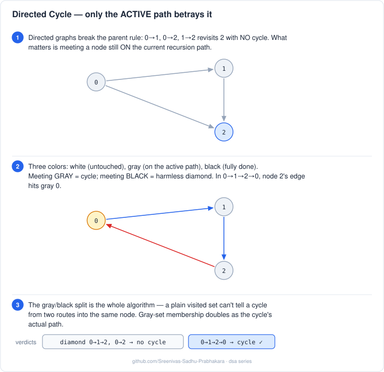

# Cycle in Directed Graph (DFS)

> Striver SDE Sheet 157 · Day 23 Graph — three colors, not two: only an edge into a vertex on the *current path* proves a directed cycle. Go, stdlib only, tested.

## Problem

Cycle detection in a *directed* graph — where the undirected tricks break: a vertex reached by two different routes (a diamond) is perfectly acyclic, so "visited = cycle" gives false positives.

## Approach

Three vertex states. White: untouched. **Gray: on the recursion path right now.** Black: completely explored, provably cycle-free. An edge into a gray vertex is a back edge into our own ancestry — a directed cycle, the only kind of edge that is one. An edge into a black vertex is harmless (that subgraph was already cleared), which is exactly the diamond case the two-state version gets wrong — and the test pins it. The gray set is equivalently "the recursion stack", which is how the same algorithm is often phrased; un-graying on return (`state[v] = black`) is the step that distinguishes path membership from mere visitedness.

**Complexity:** O(V+E) time, O(V) recursion.

## Visual walkthrough

Read the picture top to bottom — each numbered frame is one moment of the algorithm
running on this repo's test example.

## Run

    go test ./...   # verify
    go run .        # demo

---

One of 191 repos solving Striver's SDE Sheet in Go — stdlib only, one problem per repo, every solution tested. Browse the set: [`dsa-*` repos](https://github.com/Sreenivas-Sadhu-Prabhakara?tab=repositories&q=dsa-&type=source).
